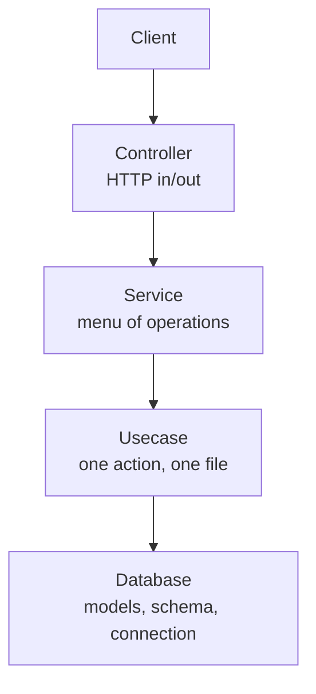

# Learning Guide: Rocket + Diesel Clean Architecture

A guide for students and readers who want to understand how this backend works and why it is built this way. Read it top to bottom once, then keep it as a reference.

**Prerequisites**: basic Rust (ownership, `struct`, `enum`, `Result`/`Option`), basic SQL, and a rough idea of what HTTP is.

**What you will learn**
- How a web request travels through a backend.
- Why the code is split into four layers.
- How Diesel maps Rust structs to SQL tables.
- How to add new features by hand and with the generator.

---

## 1. The Core Idea: Separation of Concerns

A backend does four different jobs:

| Job | Question it answers |
|---|---|
| Talk HTTP | What did the client ask for, and how do I reply? |
| Organize operations | Which operations does this domain offer? |
| Do the work | What exact query or rule runs for this action? |
| Describe data | What do the tables and rows look like? |

If one file does all four, every change risks breaking something unrelated. This project gives each job its own layer:



**Rule of thumb**: a layer may only talk to the one directly below it.

---

## 2. Follow One Request

The best way to learn is to trace a real request. Take `GET /products/`:

1. **`src/main.rs`**: Rocket starts and mounts `/products` to `controllers::products::controller::get_routes()`.
2. **`src/controllers/products/product.controller.rs`**: the `list_products` route matches the request, calls `ProductController::list_products()`, which queries `ProductService::get_all_products()`.
3. **`src/services/product_service.rs`**: forwards to `get_all_products::execute()`.
4. **`src/usecases/product/get_all_products.rs`**: opens a connection, runs the Diesel query, returns `Result<Vec<Product>, String>`.
5. Back in the controller, `Ok(vec)` becomes a JSON response and `Err(msg)` becomes an HTTP error.

**Try it**: open those four files side by side and follow the function calls yourself.

---

## 3. Layer by Layer

### 3.1 Database layer (`src/database/`)

Holds **definitions only**, no logic.

- `schema.rs`: generated by the Diesel CLI. The `table!` macro tells Rust the column names and SQL types.
- `models.rs`: Rust structs that match the tables.
- `connection.rs`: opens a PostgreSQL connection using `DATABASE_URL`.

**Why two structs per table?**

```rust
pub struct Product { id, name, created_at, ... }   // a row that already exists
pub struct NewProduct<'a> { name: &'a str }         // data needed to create one
```

The database fills in `id`, timestamps and audit fields itself. When inserting, you only supply what the database cannot decide. `Product` is read from the database (`Queryable`, `Selectable`); `NewProduct` is written to it (`Insertable`).

**Why migrations?** A migration is a versioned SQL change.
- `up.sql` applies it, `down.sql` reverts it.
- Everyone on the team and every environment ends up with the same schema.
- Never edit the database by hand; write a migration.

```powershell
diesel migration run     # apply pending migrations
diesel migration redo    # revert and re-apply the latest one
```

### 3.2 Usecase layer (`src/usecases/`)

**One file = one action.** This is the only place that contains real queries and business rules.

```rust
pub fn execute(name: &str) -> Result<Product, String> {
    if name.trim().is_empty() {
        return Err("Name cannot be empty".to_string());   // validation
    }
    let mut conn = establish_connection();
    diesel::insert_into(products::table)
        .values(&NewProduct { name })
        .returning(Product::as_returning())
        .get_result(&mut conn)
        .map_err(|e| e.to_string())                        // DB error -> String
}
```

Things worth understanding:
- **`Result<T, String>`**: failures are values, not crashes. The caller decides what HTTP status to return.
- **`.map_err(|e| e.to_string())`**: converts Diesel's error type into a plain message so upper layers don't depend on Diesel.
- **`.optional()`** (in `get_product.rs`): turns "no row found" from an error into `Ok(None)`, which lets the controller return `404` instead of `500`.
- **Why one file per action?** Small files are easy to find, review and test, and no file grows into an unreadable blob.

### 3.3 Service layer (`src/services/`)

A service is the **public menu** for one domain.

```rust
impl ProductService {
    pub fn get_all_products() -> Result<Vec<Product>, String> {
        get_all_products::execute()
    }
}
```

It looks like pure forwarding today, and that is intentional. It gives controllers one stable thing to call. When an operation later needs several steps (for example "create order, then reduce stock"), that orchestration lives here and the controller does not change.

**Boundary rule**: `ProductService` only uses `usecases/product/`. A service never reaches into another entity's usecases.

### 3.4 Controller layer (`src/controllers/`)

The only layer that knows about HTTP. Controllers are organized into domain folders (e.g., `src/controllers/products/`):

- `<name>.interface.rs`: Defines the controller contract as a Rust trait (`IProductControllerInterface`) along with request payload DTOs (`CreateProductPayload`) and response types (`ProductResponse<T>`).
- `<name>.controller.rs`: Implements the interface trait on a controller struct (`ProductController`), plus Rocket route handlers that delegate to the controller.

```rust
// In product.interface.rs:
pub trait IProductControllerInterface {
    fn get_product(id: &str) -> ProductResponse<Product>;
    // ... other methods
}

// In product.controller.rs:
pub struct ProductController;

impl IProductControllerInterface for ProductController {
    fn get_product(id: &str) -> ProductResponse<Product> {
        let parsed_id = match Uuid::parse_str(id) {
            Ok(u) => u,
            Err(_) => return Err(error_response(Status::BadRequest, "Invalid UUID format".into())),
        };
        match ProductService::get_product_by_id(parsed_id) {
            Ok(Some(item)) => Ok(Json(item)),                                   // 200
            Ok(None)       => Err(error_response(Status::NotFound, "...".into())), // 404
            Err(err)       => Err(error_response(Status::InternalServerError, err)), // 500
        }
    }
}

// Route handler delegates to the Controller implementation:
#[get("/<id>")]
fn get_product(id: &str) -> ProductResponse<Product> {
    ProductController::get_product(id)
}
```

Key points:
- `IProductControllerInterface` acts as the interface contract (equivalent to TypeScript `interface IProductControllerInterface`).
- `ProductController` implements this trait with the concrete business delegation.
- Rocket route handlers (`#[get]`, `#[post]`) map HTTP endpoints directly to controller methods.
- `#[get("/<id>")]` is a **route attribute**; `<id>` is a path parameter passed to the function.
- `Json<T>` converts between JSON and Rust structs using Serde, in both directions.
- Status codes tell the client what went wrong: `400` bad input, `404` not found, `500` server fault.
- The controller **never calls a usecase directly**. It always goes through a service.

---

## 4. Golden Rules

| Do | Don't |
|---|---|
| One usecase per file | Put several actions in one file |
| Controllers call services | Call usecases from controllers |
| Keep models and schema free of logic | Write queries in `database/` |
| Return `Result` and map to HTTP in the controller | `unwrap()` or panic on user input |
| Define traits & DTOs in `<name>.interface.rs` | Pollute the controller with raw structs |
| Folder controllers per domain (`controllers/<domain>/`) | Put loose flat controller files in `src/controllers/` |
| Change the schema through migrations | Edit tables by hand |

---

## 5. Hands-On Practice

Do these in order. Each one reinforces one layer.

1. **Run it.** Set `DATABASE_URL` in `.env`, run `diesel migration run`, then `cargo run`.
2. **Poke the API.**
   ```powershell
   curl -X POST http://127.0.0.1:8000/products/ -H "Content-Type: application/json" -d '{"name":"Book"}'
   curl http://127.0.0.1:8000/products/
   curl http://127.0.0.1:8000/products/not-a-uuid
   ```
   Predict each status code before you run it.
3. **Break it on purpose.** Send an empty name. Delete the same id twice. Remove `DATABASE_URL`. Find which layer produces each error.
4. **Add a usecase.** Create `count_products.rs` returning the number of rows (hint: Diesel's `.count().get_result::<i64>(...)`), and register it in `usecases/product/mod.rs`.
5. **Expose it.**
   - Add `ProductService::count_products()`.
   - Add `fn count_products() -> ProductResponse<i64>;` to `IProductControllerInterface` in `product.interface.rs`.
   - Implement `count_products` on `ProductController` in `product.controller.rs`.
   - Add the `#[get("/count", rank = 1)]` route handler and register it in `routes![...]`. Note the `rank` parameter so `/count` is not captured by `/<id>`.
6. **Use the generator.** Run `cargo gen categories` and read every file it produced. Compare them to the product files.
7. **Capstone.** Design your own table (for example `notes` or `courses`) and write all four layers by hand without the generator.

---

## 6. Common Mistakes

| Symptom | Likely cause |
|---|---|
| `DATABASE_URL must be set` or connection failure | Missing or wrong `.env` file |
| Compile error about a missing table or column | `schema.rs` is out of date; run `diesel migration run` |
| Route returns 404 for a path that exists | Controller not mounted in `main.rs`, or route missing from `routes![...]` |
| `cannot find module` | New file not declared in the folder's `mod.rs` |
| `500` on a bad id | Invalid input isn't validated in the controller |

---

## 7. Self-Check Questions

Answer these without looking. If you get stuck, revisit the section in brackets.

1. Name the four layers in order. (§1)
2. Why are there both `Product` and `NewProduct`? (§3.1)
3. Why does a usecase return `Result<T, String>` instead of panicking? (§3.2)
4. What is the purpose of a service if it only forwards calls? (§3.3)
5. Which layer decides between `400`, `404` and `500`, and why? (§3.4)
6. What does `.optional()` change? (§3.2)
7. What does a migration's `down.sql` do? (§3.1)
8. Which files must you touch to add one new endpoint? (§5, step 4-5)

---

## 8. Where to Go Next

- Add authentication and per-user data.
- Replace the `String` errors with a custom error enum.
- Add connection pooling instead of opening a connection per call.
- Write tests for usecases against a test database.

Further reading:
- [The Rust Book](https://doc.rust-lang.org/book/)
- [Rocket guide](https://rocket.rs/guide/)
- [Diesel getting started](https://diesel.rs/guides/getting-started)
